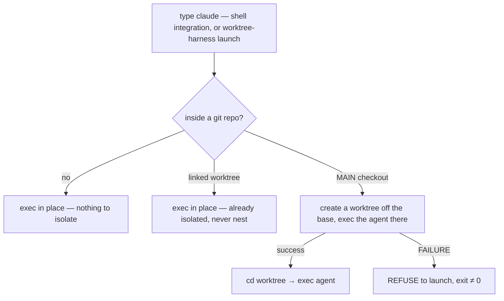
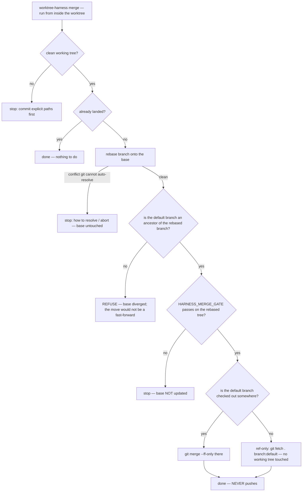

# Design

`worktree-harness` follows from one structural fact — a git worktree has its own
index, HEAD, and reflog — and the disciplines that fact makes possible: no lock,
isolate-or-refuse, fast-forward-only landing behind a gate, an explicit base, and
conservative cleanup. This document is the *why* behind each — the parts worth
understanding before you trust a tool to move your branches around.

## The whole design follows from one structural fact: each worktree has its own index

Run several coding agents on a single checkout and they share **one git index**.
The moment one session stages with `git add -A` (or an agent commits "all
changes"), it can sweep up another session's half-written work into its own
commit. They also fight over dev/inspector ports. People reach for a lock file,
a daemon, or a "only one agent at a time" rule.

None of that is necessary. `git worktree` gives every working tree **its own
index, its own HEAD, and its own reflog**, all backed by the one shared object
store. So:

> The staged-file collision isn't *prevented* by coordination — it's
> *impossible*. There is no shared staging area to collide on.

That's the whole foundation. Each session gets a worktree; isolation is
structural, not cooperative.

```
 you, in N panes (each: `claude`, or `worktree-harness launch claude`)
 ┌───────────┬───────────┬───────────┐
 │  pane 1   │  pane 2   │  pane 3   │
 └─────┬─────┴─────┬─────┴─────┬─────┘
       │           │           │   from the MAIN checkout (.git is a dir) → isolate
       ▼           ▼           ▼
 ┌───────────┬───────────┬───────────┐
 │  wt: A    │  wt: B    │  wt: C    │  separate working tree
 │ branch A  │ branch B  │ branch C  │  separate index / HEAD / reflog
 │ base:main │ base:main │ base:main │  each branched off the base at creation
 │ own ports │ own ports │ own ports │  .env copied, deps installed, .harness.env
 └─────┬─────┴─────┬─────┴─────┬─────┘
       └───────────┼───────────┘
                   ▼
        one shared  <repo>/.git   (objects + refs; content-addressed, atomic)
        refs/heads/{ main, A, B, C }
```

## No lock is needed — the only shared mutable state is refs, which git already serializes

A lock exists to serialize access to a shared mutable resource. After worktrees,
the only shared mutable thing is `refs/heads/*` — and git already serializes ref
updates with a per-ref `.lock` held for microseconds. The working trees and
indexes, the thing a lock would protect, are no longer shared.

So `worktree-harness` ships **no lock and no daemon**. An earlier iteration of
this idea (in the project it was extracted from) carried a session-long writer
lock; it turned out to be a pure DX regression — it blocked other sessions for
no safety benefit, because the worktrees had *already* removed the collision it
was guarding. Deleting it was the fix.

What still needs ordering is **landing** branches — and that's handled by
fast-forward-only discipline plus git's own ref lock, not a tool-level lock (see
below).

## `launch` isolates before it runs your agent — or refuses, never silently falling back



The last branch matters. If creating the worktree fails, the launcher does
**not** quietly run the agent on the main checkout — it exits non-zero and tells
you to fix it (or set `WH_ISOLATION_SKIP=1` to opt out explicitly).

This is the **fail-open lesson**, learned the hard way: a guard that silently
does nothing when it can't do its job is worse than no guard, because you *think*
you're protected. A `PreToolUse`-style hook that errors and is ignored "fails
open" — it lets the unsafe thing through. So isolation here **fails closed**: no
worktree, no launch.

## `merge` lands fast-forward-only, behind your gate, and never pushes

Landing a branch is where the real damage happens — a non-fast-forward clobber,
a stale-remote push, a "looks merged but didn't typecheck" regression. `merge`
makes the boring, safe move in one command (the base is `origin/<default>` when
`HARNESS_BASE_POLICY=origin`, else your local `<default>`):



Three deliberate properties:

1. **Fast-forward only.** The branch is rebased onto the base first, then an
   ancestry check confirms the move is a true fast-forward before anything is
   touched. A diverged base is refused loudly, not forced.
2. **Gated.** A clean *textual* rebase can still be *semantically* broken.
   `HARNESS_MERGE_GATE` (your typecheck/test command) runs on the rebased tree
   before the default branch moves — catching breakage a merge would otherwise
   hide.
3. **Never pushes.** Landing is local. Pushing is a separate, explicit decision.
   This is a direct response to a real footgun in a popular alternative, whose
   "checkout" key auto-pushes to the remote (claude-squad
   [#122](https://github.com/smtg-ai/claude-squad/issues/122)) — dangerous when
   your origin is stale.

Concurrent merge-backs serialize naturally: each is a fast-forward of one ref,
and git's per-ref lock orders them in microseconds. A non-fast-forward is
rejected, so a race can never clobber — the loser just re-rebases and retries.

## Base policy is explicit because "origin is canonical" is wrong for solo and diverged-fork workflows

Most repos: `origin/main` is the truth, you branch off it, you push back. That's
the default (`HARNESS_BASE_POLICY=origin`): fetch, branch off `origin/<default>`,
rebase onto it at merge time.

But some workflows invert this — a solo developer (or a fork that has diverged
far from upstream) where the **local** default branch is canonical and `origin`
is stale or rarely pushed. There, fetching and basing on `origin` is exactly
wrong: you'd branch off outdated code. Native `claude -w` assumes origin is
canonical and even silently no-ops on non-GitHub remotes
([#27947](https://github.com/anthropics/claude-code/issues/27947)).

`HARNESS_BASE_POLICY=local` makes the local default branch the base, never
touching the network. It's a first-class option precisely because the
origin-canonical assumption, baked in everywhere else, is wrong for this case.

## `gc` keeps anything it isn't certain is disposable

`gc` removes a worktree only if it passes **every** gate — clean tree, fully
merged into the default branch, not busy, not open by a live process, and idle
longer than `HARNESS_GC_IDLE_MIN`. Anything else is **kept**, with a printed
reason. **Branches are always preserved** (delete merged ones yourself with
`git branch -d`). The default is a dry-run; `--prune` actually removes.

The bias is intentional: the cost of keeping a worktree too long is a little
disk; the cost of reaping one with unmerged or in-flight work is lost work.

## Structural isolation covers staging collisions, not semantic collisions in shared derived state

Separate indexes prevent *staging* collisions. They do **not** prevent
*semantic* collisions in **shared derived state** — artifacts two worktrees both
generate from a shared counter or registry. The canonical example: a database
migration framework whose journal indexes monotonically. Two worktrees that each
generate "migration 0042" produce a real conflict.

This is not silent corruption. It surfaces where it should — as a merge conflict
in the journal file, or as a failed pre-commit/merge gate in the lagging
session. The remedy is ordinary: rebase and regenerate. The operational rule is
simply *don't run two schema-generating (or lockfile-regenerating) sessions at
the exact same moment*, and let the gate catch it if you do.

`worktree-harness` keeps its own generated file (`.harness.env`) out of this
entirely by registering it in the repo's local `.git/info/exclude`, so it never
trips the clean-tree or dirty gates.

## Non-goals: what `worktree-harness` deliberately is not

- **Not a TUI/GUI.** It's a set of composable shell commands with clean exit
  codes — wire it into scripts, hooks, and CI. For watching many agents
  visually, use a tool built for that.
- **Not an agent multiplexer.** It doesn't broadcast prompts or auto-approve
  tool calls. It manages worktree *lifecycle*; what runs inside is your agent.
- **Not a push/PR tool.** It lands locally and stops. Your `git push` / PR flow
  is unchanged and explicit.
- **No new runtime dependencies, ever.** git + bash. That constraint is the
  product.

## Glossary

The nouns the commands, help and docs use, each with what identifies it. Where a
noun has an identity, the first form listed is the one printed on stdout.

| Noun | Meaning | Identity |
|---|---|---|
| **worktree** | A git working tree the tool creates, lists or removes | Its absolute path, as `new` prints it (and `gc --prune` for removed ones). Commands act on the worktree you run them in, or the one `--cwd <DIR>` names |
| **main checkout** | The repository's original working tree, whose `.git` is a directory | Its absolute path; `kind` is `main` in `status --json`. `gc` never removes it |
| **linked worktree** | Any worktree added with `git worktree add`, whose `.git` is a file | Its absolute path; `kind` is `linked`. `launch` runs in place inside one |
| **branch** | A git branch, checked out in one worktree | Its short name (`add-auth`), the `<BRANCH>` in `new <BRANCH>`; `status` shows `detached` when a worktree has none |
| **default branch** | The branch `merge` fast-forwards and `gc` checks "merged" against | Its short name: `HARNESS_DEFAULT_BRANCH`, else the remote's `HEAD`, else a local `main` or `master`, else the current branch |
| **base** | The ref `new` branches from and `merge` rebases onto | `<remote>/<default>` under `HARNESS_BASE_POLICY=origin`, `<default>` under `local` |
| **merge gate** | The command in `HARNESS_MERGE_GATE`, run on the rebased tree before the fast-forward | The command text; `merge --no-verify` skips it |
| **busy marker** | A `.worktree-harness-busy` file in a worktree; `gc` keeps a worktree that has one | The file's presence |
| **port offset** | The number added to every `HARNESS_PORTS` base for one worktree; the smallest free one, so a removed worktree's offset is reused | `N` in the `# harness-offset=N` first line of `<worktree>/.harness.env` |
| **`.harnessrc` setting** | A `HARNESS_*` variable assigned in `.harnessrc`. Exporting one in your shell has no effect: the defaults are reset before the file is sourced | The variable name. `WH_*` names are per-run environment variables; `WORKTREE_HARNESS_*` names are read by `install.sh` and the shell integration |

Words kept out of copy, option names and positional names:

- **"flag"**: say **option**.
- **"trunk"**: say **default branch**.
- **"session" meaning a worktree**: a session is the agent process running in a
  worktree, not the worktree itself.

## Exceptions

Places where the tool knowingly departs from the CLI conventions it otherwise
follows, each kept so that existing scripts and installs keep working. Each entry
gives the rule, what the tool does instead, why, what it means for you, and the
test that holds the behavior in place.

**Exit codes (R337).** The convention reserves 2 for usage errors and 1 for
operational failures. The tool keeps its documented codes: 1 for an error or a
usage error, 64 for an unknown command, 2 for a `merge` rebase conflict, the
number of blocking issues for `doctor`, and `launch` passes through its
command's code. *Why:* scripts already test these codes (decision packet
`ad226c7513ea`). *Impact:* a script can't tell a usage error from an operational
one by code alone; the codes are listed in `worktree-harness --help` and in the
help of `merge`, `gc` and `doctor`. *Tests:* `dispatcher.bats` "unknown command
exits 64", `merge.bats` "a rebase conflict exits 2 and leaves main alone",
`doctor.bats` "doctor counts each invalid key", `common.bats` "usage die exits
WH_EXIT_USAGE and names the help command".

**`gc --prune` without a prompt (R146).** The convention asks a destructive
command to get consent, and to require `--yes` when it can't prompt. `gc --prune`
removes without a prompt, interactive or not. `-y, --yes` is accepted for
scripts but never removes on its own: `gc --yes` previews, `gc --prune --yes`
removes. *Why:* `gc` already previews by default, so `--prune` is the explicit
act (packet `ad226c7513ea`). *Impact:* a script that runs `gc --prune` removes
every worktree that passes the checks. Removing a worktree deletes its ignored
files such as `.env`; branches are always kept. *Tests:* `gc.bats` "gc --prune
removes non-interactively without a prompt", "gc --yes alone only previews",
"gc --prune --yes removes".

**Target named in argv (R156): not reached.** The convention asks a destructive
command to name its target in its arguments rather than infer it. It applied
only to the consent tier `gc` and `install.sh --force` would have added. Both
were kept as they are (above, and the installer entry below), so neither the
tier nor this exception exists: `gc --prune` removes the set it computes from
local state, and `install.sh` replaces its two fixed paths under the prefix.

**Unknown evidence in `--porcelain`, and a guessed default branch (C3).** The
convention says a value git couldn't compute must not read as a real one. Two
places keep today's behavior. `status --porcelain` prints `+0/-0` and no dirty
mark when git can't answer; the table shows `?` with a warning, and `--json`
shows `null`. `gc` doesn't refuse when the default branch is only a guess (the
current-branch fallback). *Why:* the porcelain columns are a documented script
interface, and refusing would break `gc` in repos where it works today (packet
`ad226c7513ea`). *Impact:* scripts that must tell zero from unknown should read
`status --json`. In a repo with no `main`, no `master` and no remote `HEAD`, set
`HARNESS_DEFAULT_BRANCH` so `gc` judges "merged" against the right branch.
*Tests:* `status.bats` "a failed compare stays silent +0/-0 under --porcelain"
and "a failed dirty check is ? for people, empty for --porcelain, null for
--json". No test pins the guessed-branch case.

**A failed fetch warns and continues (R292, C5).** The convention treats a
network failure as a failure. When the fetch for the base fails, `new`,
`launch` and `merge` warn and continue from the last-known remote ref. The
warning names the branch, the remote, its URL with credentials removed and
git's first error line. The fetch can't prompt for credentials or hang on a
stalled connection. An unknown `HARNESS_PACKAGE_MANAGER` or a malformed
`HARNESS_PORTS` entry also stays a warning. *Why:* offline work keeps working
(packet `ad226c7513ea`). *Impact:* offline, a worktree may branch from (and
`merge` may rebase onto) a stale remote ref; read the warning. `WH_NO_FETCH=1`
skips the fetch on purpose. *Test:* `config.bats` "a failed fetch names the
remote and continues".

**`install.sh` replaces without an ownership check (C7, D-R2-4 (b)).** The
convention asks an installer to replace only what it installed. `install.sh`
replaces `<prefix>/share/worktree-harness` and `<prefix>/bin/worktree-harness`
whatever created them; there is no ownership marker and no `--force`. *Why:*
keeps every existing install upgradable by re-running the installer. *Impact:*
pointing the installer at a prefix another tool manages replaces that tool's
files; the receipt then ends with a `Replaced` line. Homebrew installs live under Homebrew's
prefix, so use `brew upgrade` there. *Tests:* `install.bats` "reinstall replaces
the tree", `install_output.bats` "fresh, replaced, and unchanged receipts".

**No time limit on the installer's clone over ssh (R313).** The convention
bounds every network call. The clone stops if it moves less than 1000 bytes a
second for 60 seconds over HTTP(S); there is no wall-clock bound, and an
`ssh://` or `git@` `WORKTREE_HARNESS_REPO` is unbounded. *Why:* stock macOS has
no `timeout`, and `CONTRIBUTING.md` forbids a new dependency. *Impact:* a
stalled ssh clone waits until you press Ctrl+C, which removes the temporary
clone. *Tests:* `install.bats` "TERM during the clone exits 143 fast and cleans
up" and "HUP during the clone exits 129 fast and cleans up" pin the interrupt
path; no portable test can stall a clone.

**`--version` prints the name too (R086, D-R2-17).** The convention prints the
bare version. `worktree-harness --version` (and `-v`, and `version`) prints
`worktree-harness 0.2.0`. `sh install.sh --version` prints the bare version.
*Why:* today's bytes, which scripts may match. *Impact:* a script that wants the
number alone takes the second word. *Tests:* `dispatcher.bats` "version prints
name and a version", `common.bats` "--version works after the command and
--help wins".

**`status --human` stays accepted (R438, D-R2-16).** The convention allows one
option per output format. `--porcelain` and `--json` are the documented
formats; `--human`, which forces the aligned table when piped, is still
accepted but appears in no help, README or completion. *Why:* existing callers.
*Impact:* none for new scripts. *Tests:* `status.bats` "--human stays accepted,
isn't advertised, and can't combine with --json", "--human forces the aligned
table when piped".

**The progress arrow (R182, D-R2-6 (b)).** The convention leaves the progress
gutter blank. On a terminal, progress lines from the CLI and `install.sh` keep
their `→`, and progress copy reads as a present participle ending in `…`
(`→ Fetching origin main…`). *Why:* the glyph is part of the familiar output and
of the recorded demo. *Impact:* cosmetic. *Tests:* `common.bats` "a TTY stderr
gets glyphs and colour while a piped stdout stays plain", `install_output.bats`
"rich rows use the 16-character label column".

**Installer offers print without a terminal (R240, D-R2-13 (b)).** The
convention prints optional offers only to an interactive terminal. `install.sh`
prints its shell-integration and completion offers in every mode, including
`curl | sh`, unless `CI` or `WH_GUIDANCE_DISABLED` is set; the PATH warning
always prints. The CLI's own offers still need a terminal. *Why:* under
`curl | sh` stdin is the script, so a terminal check would hide the offers
from the most common install. *Impact:* non-interactive install logs include
the offer lines; the README lists the same steps. *Tests:* `install_output.bats`
"offers are real commands for the detected shell only, without a terminal" and
"optional offers are hidden in CI"; `common.bats` "offers need a stdin TTY and
stay off for CI, JSON mode and disabled guidance" for the CLI.

**No `install.sh --fields` (R252, D-R2-15).** The convention gives a command
with a result schema a `--fields` option. `install.sh --json` prints a result
document, but `install.sh` has no `--fields`; it is an unknown option and exits
2. *Why:* the document is an install path and version, an outcome, the next
command and any warnings, too small to need trimming. *Impact:* none. *Test:* `install.bats`
"an unknown option exits 2 and names it".

**`-C` and `-V` are accepted silently (D-R2-1 (b)).** The convention gives each
option one spelling. `--cwd <DIR>` and `-v, --version` are the documented
spellings; `-C <DIR>` and `-V` still work, with no warning, and appear in no
help, README or completion. *Why:* `-C` mirrors `git -C`, and the Homebrew
formula's test runs `-C`. *Impact:* none; prefer the documented spellings.
*Tests:* `dispatcher.bats` "-V and -C stay accepted and silent", `common.bats`
"--cwd and -C change directory identically".
